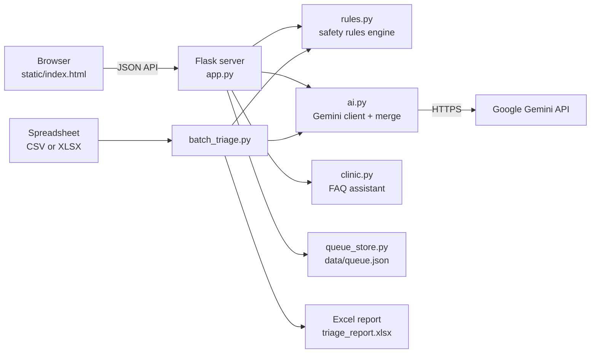
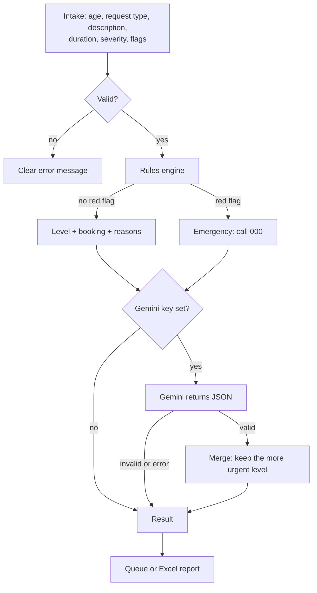
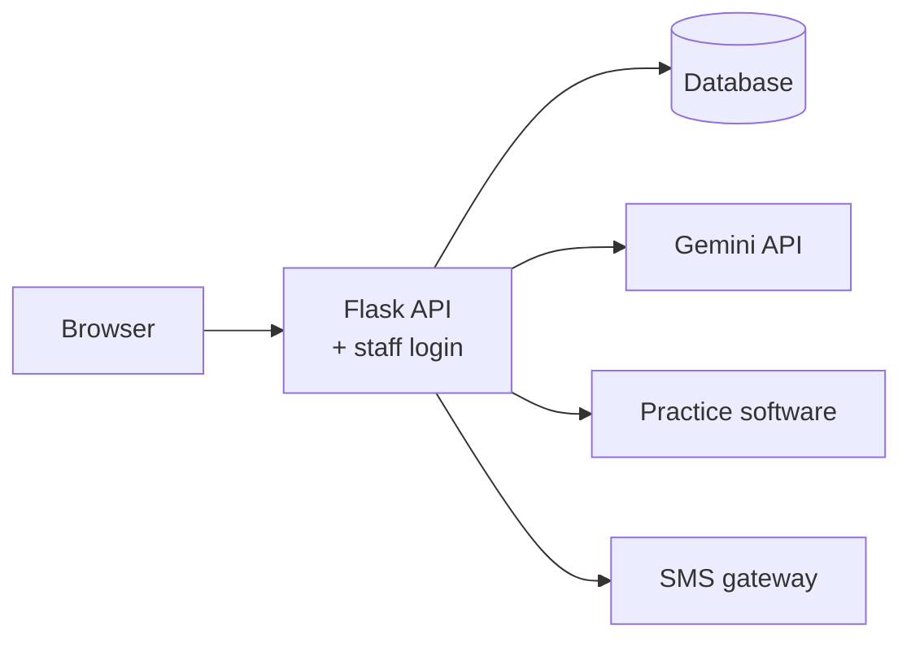

# ClinicPilot: Architecture

## Components

| Component | Language | Responsibility |
|---|---|---|
| `clinicpilot/rules.py` | Python | Validates input (`Intake`) and runs the safety rules (`triage`). Returns a `TriageResult` |
| `clinicpilot/ai.py` | Python | Holds the triage prompt and calls Gemini (`GeminiClient`). Validates the JSON and merges it with the rules result (`merge`) |
| `clinicpilot/clinic.py` | Python | Holds the clinic knowledge base, the offline FAQ matcher and the AI chat prompt |
| `clinicpilot/queue_store.py` | Python | Thread-safe reception queue in a JSON file, with priority sorting and CSV export |
| `app.py` | Python (Flask) | Serves the web page and the JSON API |
| `batch_triage.py` | Python (openpyxl) | Reads CSV or XLSX, triages every row and writes the Excel report |
| `static/index.html` | HTML, CSS, JavaScript | The screens: intake form, queue, chatbot |

## How one request flows

## Why rules first, AI second
| | Rules engine | Gemini AI |
|---|---|---|
| Strength | Predictable, testable, works offline, never misses a listed red flag | Understands varied wording; writes natural messages and summaries |
| Weakness | Only knows the patterns it was given | Can be wrong or inconsistent; needs internet and a key |
| Role | Sets the **minimum** urgency (safety floor) | Can **raise** urgency and improve the wording |

Because of the guardrail, an AI mistake can only make a result more cautious, never less.

## Technology choices
| Choice | Reason |
|---|---|
| Python for all logic | Same engine used by the web app and the batch script; easy to test with pytest |
| Flask | Small, well-known web framework; a few lines per API route |
| Gemini called from the server | API key stays private; the browser never sees it |
| JSON response mode, temperature 0.2 | Output is parseable and consistent |
| openpyxl | Builds real Excel files with colours, filters and frozen headers |
| JSON file for the queue | No database setup needed for a demo |
| A fake AI client in the tests | Tests run free, offline and give the same result every time |

## Data and privacy
- Only the intake details are sent to Gemini: age, request type, description, duration, severity and flags.
- Patient names are never sent, and a test checks this.
- The API key is read from `.env` or an environment variable, and `.env` is excluded from Git.

## Production version (next step)

